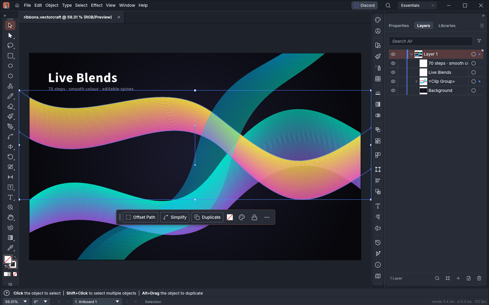
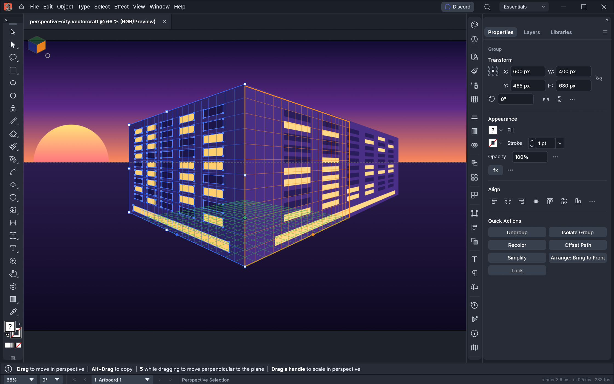

# Atelier Quill

**Vector illustration for the Nation.** Paths, shapes, type, gradients, blends, effects, artboards,
SVG and PDF, in a native app written in Rust. Runs on macOS, Windows, Linux and in the browser.
Offline, no account, no cloud.

Quill is one of the Atelier apps, Aetherion Nation's own creative suite. It is built on
[VectorCraft](https://github.com/storytold/vectorcraft) by the ArtCraft team (MIT OR Apache-2.0),
and keeps pulling their work in: VectorCraft is the engine, Atelier is the house it lives in.

| What | Where |
|---|---|
| Run it | `cargo run -p vectorcraft` (desktop) · `apps/vectorcraft-web` (browser) · `vectorcraft-cli` (headless) |
| How it is built | `docs/architecture.md`, `docs/development.md` |
| The brand layer, and what we change versus upstream | [`docs/brand.md`](docs/brand.md) |
| Pulling in upstream work | [`docs/upstream.md`](docs/upstream.md) |
| Agent and contributor rules | `CLAUDE.md`, `AGENTS.md` |

## Names

The product is **Atelier Quill**. Crates, binaries, command ids and the `.vectorcraft` document
format keep their upstream `vectorcraft` names on purpose, so that upstream changes merge
cleanly; see `docs/brand.md` before renaming anything.

---

## What's in the box

The sections below are VectorCraft's own notes, kept as upstream writes them (they still say
"VectorCraft"; in Atelier the app is Quill). They are the best description of what the app does.

## A look around

<table>
<tr>
<td width="50%" valign="top">
  
  <p align="center"><sub><b>Live Blends and Layers</b>: editable key paths, smooth colour, every object a row</sub></p>
</td>
<td width="50%" valign="top">
  
  <p align="center"><sub><b>Pen and Direct Selection</b>: real Bézier anchors and handles, plus a contextual task bar</sub></p>
</td>
</tr>
<tr>
<td width="50%" valign="top">
  
  <p align="center"><sub><b>Perspective Grid</b>: art attached to its planes stays editable in perspective · <code>examples/perspective-city.vectorcraft</code></sub></p>
</td>
<td width="50%" valign="top">
  
  <p align="center"><sub><b>Multiple artboards, light theme</b>: Pathfinder · Gradient Mesh · live radial Repeat · Envelope Distort · <code>examples/feature-sheet.vectorcraft</code></sub></p>
</td>
</tr>
</table>

## Made in VectorCraft

Every piece below was built entirely through VectorCraft's command API, the same one the MCP server
exposes to agents, and exported by VectorCraft's own renderer. The source files are in
[`examples/`](examples).

<table>
<tr>
<td width="50%" valign="top">
  
  <p align="center"><sub><b>Neon Drive</b>: synthwave poster with glowing type and grid</sub></p>
</td>
<td width="50%" valign="top">
  
  <p align="center"><sub><b>Dusk</b>: gradient sky, glowing sun, layered mountains</sub></p>
</td>
</tr>
<tr>
<td colspan="2" valign="top">
  
  <p align="center"><sub><b>Live Blends</b>: 70 steps, smooth colour, editable spines</sub></p>
</td>
</tr>
<tr>
<td width="50%" valign="top">
  
  <p align="center"><sub><b>Radial Repeat</b>: a live mandala</sub></p>
</td>
<td width="50%" valign="top">
  
  <p align="center"><sub><b>Envelope Distort</b>: striped type warped into a flag</sub></p>
</td>
</tr>
<tr>
<td width="50%" valign="top">
  
  <p align="center"><sub><b>Gradient Mesh</b>: shaded spheres</sub></p>
</td>
<td width="50%" valign="top">
  
  <p align="center"><sub><b>Pathfinder</b>: a crescent and stars from exact booleans</sub></p>
</td>
</tr>
</table>

## Why VectorCraft

- **Familiar.** Illustrator's layout, tools, menus, panels and shortcuts: the Pen, Direct Selection,
  Pathfinder, Smart Guides, Appearance, Swatches, Layers and more. You already know how to use it.
- **Fast.** Multithreaded SIMD rendering off the UI thread. 20,000 shapes render in about 27 ms at
  full retina resolution while the interface stays at 120 fps.
- **Robust.** Exact curve booleans (no "cannot perform operation"), unlimited undo via structural
  sharing, and property-tested file round trips.
- **Open.** A documented native format (`.vectorcraft`, JSON), first-class SVG, PDF (and
  PDF-compatible `.ai`) import and export, PNG/JPEG/WebP export, Export for Screens, and SVGZ,
  templates, GIF, TIFF and BMP on open.
- **Agent-native.** Every menu item, tool gesture, panel and dialog can be driven over a JSON
  control channel and an **MCP server**, so Claude and other agents can draw, edit and export the
  way a person does.
- **Everywhere.** One codebase for the desktop apps and the same UI in the browser.

## Quick start

```sh
cargo run --release -p vectorcraft                          # desktop app
cargo run --release -p vectorcraft -- examples/dusk-poster.vectorcraft
cargo run --release -p vectorcraft -- --control 7979        # + JSON control channel
cargo run --release -p vectorcraft-cli -- mcp               # MCP server (stdio)
cargo run --release -p vectorcraft-cli -- run --in examples/ribbons.vectorcraft --export out.pdf   # headless batch
cargo run --release -p vectorcraft-cli -- bench examples/neon-drive.vectorcraft                   # render timing
cargo xtask bundle                                        # dist/VectorCraft.app (macOS)
cd apps/vectorcraft-web && trunk build --release            # web build → dist/web
cargo xtask ci                                            # fmt, clippy, tests, layering, wasm, vendor names
```

Japanese fonts come from [storytold/craft-fonts](https://github.com/storytold/craft-fonts), an optional
build input (releases always use it): `CRAFT_FONTS_DIR="$PWD/../craft-fonts" cargo run --release -p vectorcraft` (an absolute path).
Without it, Japanese text uses the installed system fonts. See [`docs/development.md`](docs/development.md#fonts-craft-fonts-optional-build-input).

On machines with two graphics processors, VectorCraft renders on the power-saving (integrated) one by default on
Windows and macOS, and on the one the desktop runs on under Linux. To choose, use **Preferences › Performance ›
Graphics Processor** and restart. If a graphics processor can't show the window, VectorCraft starts again on the
next one. To pick one when starting the app, set `WGPU_POWER_PREF=high` (or `low`), or `WGPU_ADAPTER_NAME` to part of
its name, such as `WGPU_ADAPTER_NAME=nvidia` (see [`docs/development.md`](docs/development.md#desktop-graphics-processor)).

On native Wayland, winit 0.30 does not deliver dropped files. To open an SVG, use File › Open;
to place artwork in the current document, copy and paste the file in a file manager; or run
under XWayland (`WAYLAND_DISPLAY= vectorcraft`) for file drag-and-drop
(see [`docs/development.md`](docs/development.md#linux-wayland-and-x11)).

On Linux under KDE Plasma 6.3 or later with Wayland, a drawing tablet's pen moves the cursor but VectorCraft doesn't
respond to it yet (#491). Start the app under XWayland instead: `WAYLAND_DISPLAY= vectorcraft` (see
[`docs/development.md`](docs/development.md#linux-wayland-and-x11)).

### Use it from Claude Code and other agents

Register the MCP server with Claude Code:

```sh
claude mcp add vectorcraft -- /path/to/vectorcraft-cli mcp
```

To keep an agent to one project's files, give it folders to read and write (the same flags as PhotoCraft):

```sh
claude mcp add vectorcraft -- /path/to/vectorcraft-cli mcp --automation-read-root /work/project --automation-write-root /work/project
```

The details are in [`docs/mcp.md`](docs/mcp.md) and [`docs/control-protocol.md`](docs/control-protocol.md).

For the experimental, unsupported 64-bit Windows 7 build, see [Windows 7 instructions](docs/windows7.md).

## Status

VectorCraft is under active development. [**ROADMAP.md**](ROADMAP.md) has the stage, the numbers by dimension
and what's next; [`docs/target-app-parity.md`](docs/target-app-parity.md) the full parity assessment and
[`docs/gaps.md`](docs/gaps.md) the ranked list of what's missing.

**Where we are (2026-10-10): alpha.** About 88% of Illustrator 2026's menu items, tools, effects and formats exist
(92.5% of menu items do something), feature depth is ~75%, and we estimate ~65% "ready for real work" for a mainstream illustrator (~62% against
all of Illustrator): everyday
vector illustration is close to usable: drawing and path tools,
Pathfinder and Shape Builder, paint, gradients, appearance and transparency, type with styles, threading and Hebrew/Arabic bidirectional layout, and
files (SVG, PDF and PDF-compatible `.ai` with PDF/X, EPS, DXF, EMF/WMF, raster formats, PSD out and PSD/PSB in as their merged image, Print, Package).
Affinity documents (`.af` from Affinity 3, `.afdesign`, `.afpub` and, by their content, `.afphoto` from Affinity 1 and 2) open
and place natively: layers, groups, artboards and pages, curves and shapes, fills, gradients and strokes, clipping
and masks, text and images, with what didn't come in (effects, adjustments, brushes, master pages…) listed in the
import warning; a file whose native data can't be read opens as its embedded preview, saying why. VectorCraft
doesn't write Affinity files. Current `.af` validation includes 33 pinned files, native save/reload
and every-board SVG/PDF/PSD export, with fixes for Affinity 3 artboards, source-backed JPEGs and text runs.
[Scope and limits](crates/affinity/README.md); [source audit and remaining gaps](docs/affinity-validation.md).
The interface
speaks English, German, Japanese, Traditional and Simplified Chinese, Spanish, French, Italian, Russian and Ukrainian (and Czech and Brazilian Portuguese in the menus);
[localization-parity.md](docs/localization-parity.md) has the details.
The scores are self-assessed from our code against Illustrator's public documentation;
[target-app-parity.md](docs/target-app-parity.md#how-this-was-measured-2026-10-10) explains how far to trust them.

**What's missing:**
- reliable exchange of Illustrator's own `.ai` files (layer structure in real files; Illustrator's editing data isn't written);
- an interaction-fidelity pass covering every tool's modifiers and small behaviours;
- 3D and Materials beyond the initial live Revolve (Extrude & Bevel, Inflate, Rotate, materials);
- about half of the Photoshop-style raster effects (29 of 57 still missing) and the Effect Gallery;
- CJK composition for vertical type (vertical type itself has initial support, with a Japanese interface);
- scripting, and the rest of Variables (image and graph kinds, dataset import);
- generative AI features.

**Where we're going:** next is the interaction-fidelity pass, `.ai` files from real users and start-up stability,
alongside the raster-effects package; then type, the Illustrator 2026 additions and 3D. The ranked list is in
[`docs/gaps.md`](docs/gaps.md).

**Workspace:** `crates/{geom, color, doc, pathops, text, effects, three-d, trace, brush, render, svg, pdf, eps, cad, metafile, format, tools, engine, ui-egui, mcp, testkit}`
and `apps/{vectorcraft, vectorcraft-cli, vectorcraft-web}`. The egui frontend is its own crate, so
the UI can be swapped without touching the engine.

Agent and contributor rules (clean-room, the asset policy, no panics in shipped code, quality gates) are in
[`AGENTS.md`](AGENTS.md); [`docs/development.md`](docs/development.md#robustness-vectorcraft-never-crashes)
explains how VectorCraft avoids crashing, and [`docs/releasing.md`](docs/releasing.md) how releases are built,
signed and published. Every bundled asset is listed with its licence in [`ASSETS.md`](ASSETS.md).

## License

MIT OR Apache-2.0, like VectorCraft. Third-party material is listed in `ASSETS.md` and `NOTICE`.
The Atelier and Aetherion names and marks are not covered by the license.
